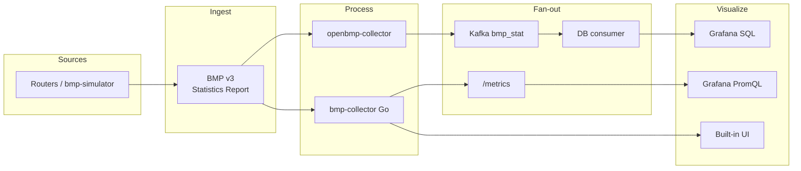

# bmp-bgp-msg-stats

Open BMP tooling for
[draft-choudhary-grow-bmp-bgp-msg-stats-00](https://datatracker.ietf.org/doc/html/draft-choudhary-grow-bmp-bgp-msg-stats-00):
BGP session PDU counters (UPDATE, KEEPALIVE, NOTIFICATION, ROUTE-REFRESH, totals)
as BMP Statistics Types TBD1–TBD10.

Also supports **BMPv4** ([draft-ietf-grow-bmp-tlv](https://datatracker.ietf.org/doc/html/draft-ietf-grow-bmp-tlv))
Stats TLV enclosure and **E-bit** enterprise Stat Types, including process CPU and
memory utilization gauges (default PEN 9).

## Architecture at a glance

Layered observability path (ingestion → processing → fan-out → visualization),
aligned with what this repo implements. Full diagrams:
**[docs/ARCHITECTURE.md](docs/ARCHITECTURE.md)**.



## Layout

| Path | What |
|------|------|
| **[`openbmp-collector/`](openbmp-collector/)** | **Primary:** OpenBMP C++ collector (fork of [OpenBMP/obmp-collector](https://github.com/OpenBMP/obmp-collector)) with draft PDU counter parsing and Kafka `bmp_stat` fields |
| Go packages / `cmd/` | Reference BMP codec, collector, and simulator for the same draft |
| [`docs/ARCHITECTURE.md`](docs/ARCHITECTURE.md) | Mermaid architecture / data-flow diagrams |
| [`docs/GRAFANA.md`](docs/GRAFANA.md) | Prometheus + OpenBMP SQL Grafana wiring |

## OpenBMP collector (recommended)

Based on the classic OpenBMP daemon. It receives BMP from routers, parses
Statistics Reports including provisional Stat Types **44–53**, and publishes
to Kafka.

```bash
cd openbmp-collector
# See openbmp-collector/docs/BUILD.md for dependencies (cmake, librdkafka, …)
mkdir build && cd build
cmake -DCMAKE_INSTALL_PREFIX:PATH=/usr ../
make
```

Details: [`openbmp-collector/docs/BGP_PDU_STATS.md`](openbmp-collector/docs/BGP_PDU_STATS.md)
and the `bmp_stat` schema in
[`openbmp-collector/docs/MESSAGE_BUS_API.md`](openbmp-collector/docs/MESSAGE_BUS_API.md).

| Draft | Provisional Type | Meaning |
|-------|------------------|---------|
| TBD1 / TBD2 | 44 / 45 | UPDATE received / sent (64-bit) |
| TBD3 / TBD4 | 46 / 47 | KEEPALIVE received / sent (32-bit) |
| TBD5 / TBD6 | 48 / 49 | NOTIFICATION received / sent (32-bit) |
| TBD7 / TBD8 | 50 / 51 | ROUTE-REFRESH received / sent (32-bit) |
| TBD9 / TBD10 | 52 / 53 | Total BGP PDUs received / sent (64-bit) |

## Go reference tools

```bash
go test ./...
go run ./cmd/bmp-collector -listen 0.0.0.0:11019 -http 0.0.0.0:18080
go run ./cmd/bmp-simulator -collector 127.0.0.1:11019
```

Useful for encoding/decoding and local demos without Kafka.  
Prometheus: `http://127.0.0.1:18080/metrics`

## Grafana

See **[docs/GRAFANA.md](docs/GRAFANA.md)**.

```bash
# collector must be listening on :18080
docker compose -f grafana/docker-compose.yml up -d
# Grafana http://127.0.0.1:13000  (admin/admin)
```

OpenBMP SQL path (Kafka → DB) is documented in the same file.

## License

- Go reference code: [BSD 3-Clause](LICENSE)
- `openbmp-collector/`: [Eclipse Public License v1.0](openbmp-collector/LICENSE) (upstream OpenBMP)
