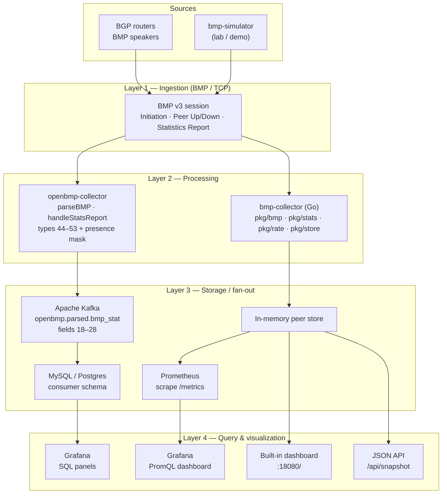
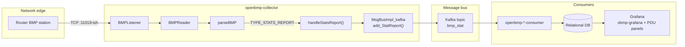
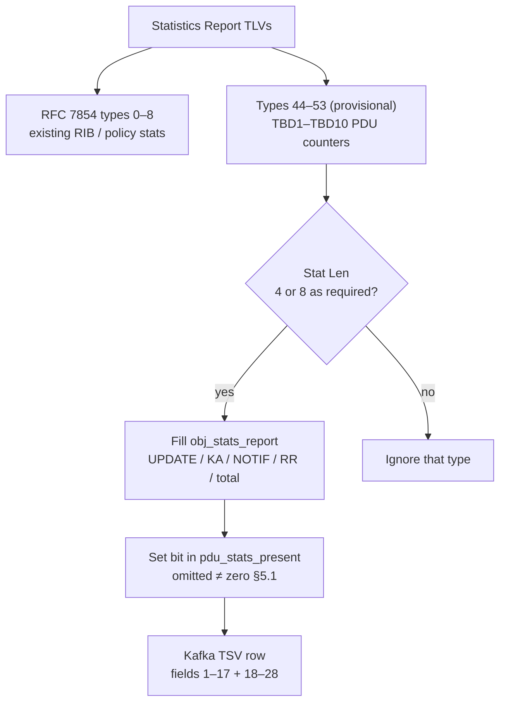
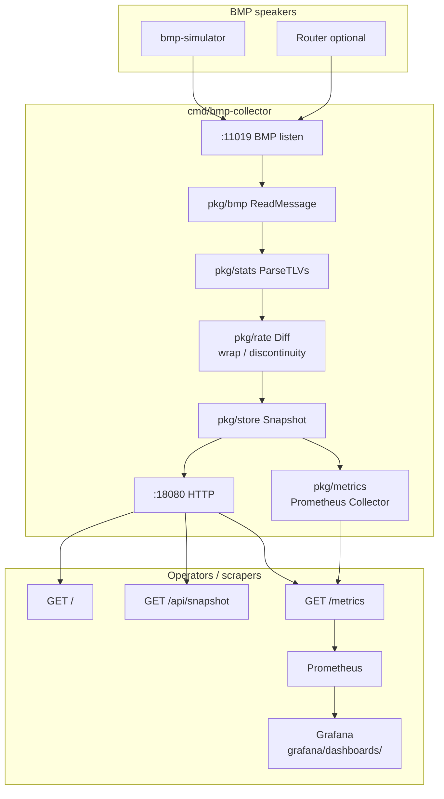
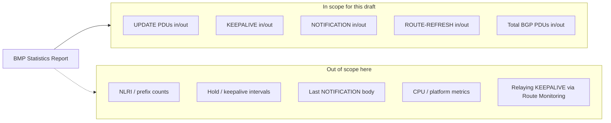
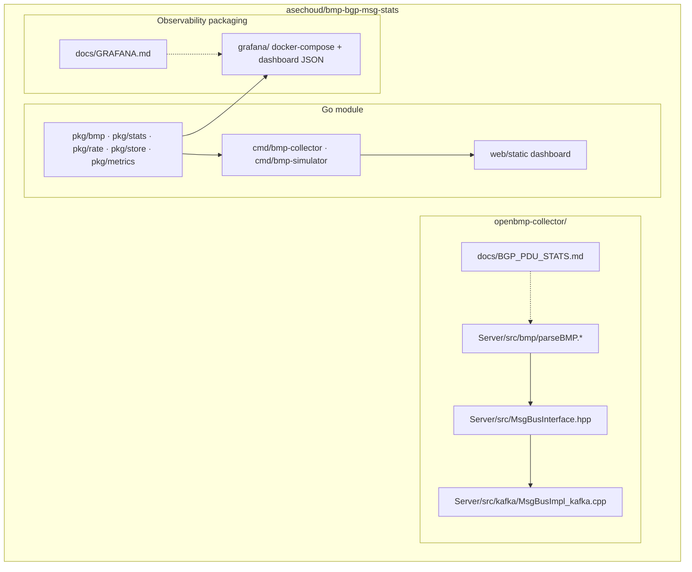

# Architecture

Layered view of how this repository turns BGP session activity into
observability signals for
[draft-choudhary-grow-bmp-bgp-msg-stats-00](https://datatracker.ietf.org/doc/html/draft-choudhary-grow-bmp-bgp-msg-stats-00).

Diagram style follows the same narrative used in large observability
platform write-ups: **ingestion → processing → storage / fan-out → query &
visualization**, with what this repo actually implements called out in each
layer.

## 1. Platform overview (two deployable paths)

Both paths share the same BMP Statistics Report encoding (provisional Stat
Types **44–53** / TBD1–TBD10). They diverge after the collector:

| Path | Ingest | Fan-out | Visualize |
|------|--------|---------|-----------|
| **OpenBMP** (primary) | `openbmpd` (BMPv3/v4) | Kafka `bmp_stat` → DB consumer | Grafana SQL ([docs/GRAFANA.md](GRAFANA.md)) |
| **Go reference** | `bmp-collector` (BMPv3/v4 + E-bit) | In-memory store + `/metrics` | Built-in UI + Prometheus → Grafana |

BMPv4 Stats Reports enclose Stats Count/data in Stats TLV type 1. Enterprise
process CPU/memory gauges use the E-bit + IANA PEN (see [IMPLEMENTATION.md](IMPLEMENTATION.md)).

## 2. OpenBMP production pipeline

Matches the classic OpenBMP collector flow, extended only on the **stats**
path for PDU counters (RIBs / Peer Up-Down continue unchanged).

**PDU-specific processing inside `handleStatsReport`:**

## 3. Go reference pipeline (lab / light deploy)

No Kafka. Suitable for demos, unit testing the draft encoding, and a small
Prometheus scrape target.

## 4. What is ingested vs what is not

Aligned with draft scope (session-layer PDU counters only):

Peer Down does **not** clear PDU counters (draft §7). Monitoring stations
derive rates from successive samples and treat decreases / new Initiation as
discontinuities (`pkg/rate`, OpenBMP consumers must do the same).

## 5. Component map (repository)

## Related docs

- [IMPLEMENTATION.md](IMPLEMENTATION.md) — draft section coverage
- [GRAFANA.md](GRAFANA.md) — Prometheus + OpenBMP SQL panels
- [openbmp-collector/docs/BGP_PDU_STATS.md](../openbmp-collector/docs/BGP_PDU_STATS.md) — collector behavior for types 44–53
- [openbmp-collector/docs/MESSAGE_BUS_API.md](../openbmp-collector/docs/MESSAGE_BUS_API.md) — `bmp_stat` field list
